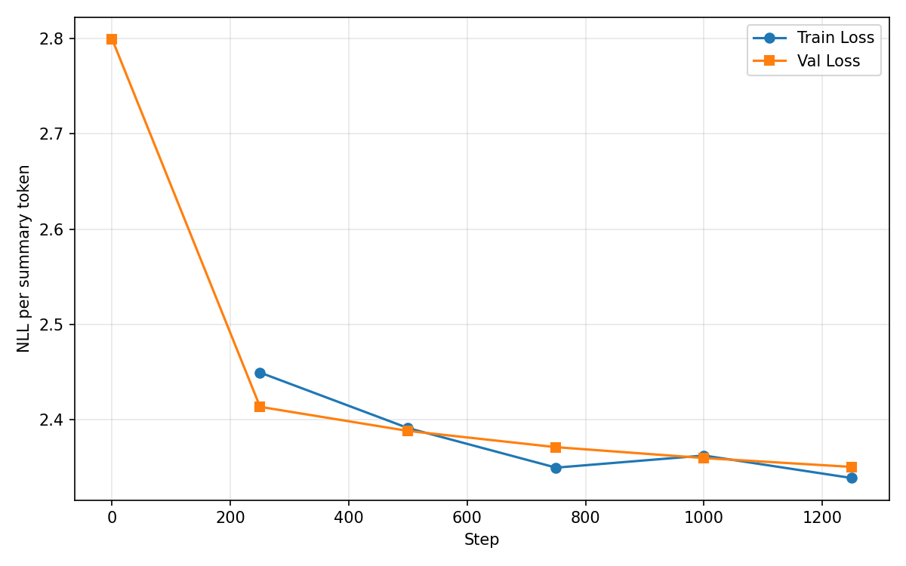
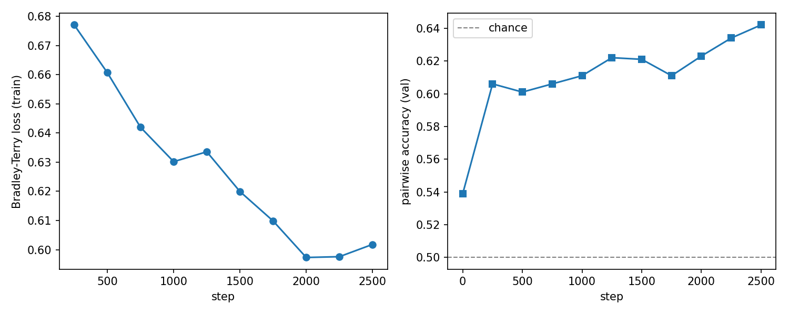
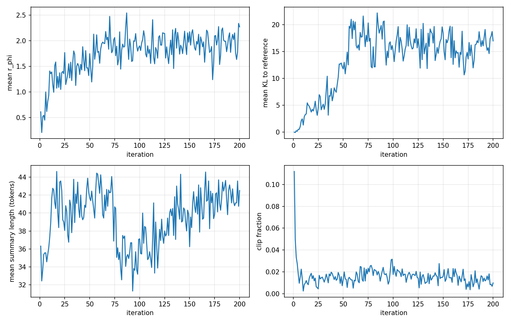
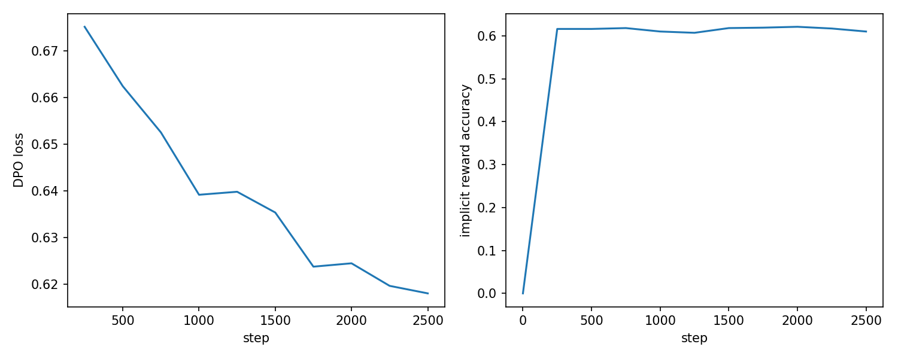

# Summarization from Human Feedback

Reproducing the RLHF pipeline of *Learning to Summarize from Human Feedback* (Stiennon et al., 2020)
with `HuggingFaceTB/SmolLM2-135M`: SFT -> reward model -> PPO, and DPO as an alternative to PPO.
All losses (SFT, Bradley-Terry, PPO, DPO) are implemented from scratch in PyTorch.

## Repository layout

```
.
├── starter/              # given data / model loading code (unchanged)
│   ├── config.py         #   fixed settings: model, datasets, sizes, seed
│   ├── models.py         #   load_tokenizer, load_causal_lm
│   ├── data.py           #   load, clean, filter, tokenise
│   ├── batching.py       #   collate_sft / collate_pref / collate_prompts
│   └── check_starter.py  #   Task 1.1 sanity check
├── common.py             # shared helpers + project paths: token_logprobs, summary mask, generation
├── train_sft.py          # Task 2 - Stage 1: supervised fine-tuning
├── train_reward.py       # Task 3 - Stage 2: reward model
├── train_ppo.py          # Task 4 - Stage 3: PPO
├── train_dpo.py          # Task 5 - Stage 4: DPO
├── evaluate.py           # Task 6 - compare SFT / PPO / DPO on 300 eval posts
├── app/                  # Task 8 - web front end
├── notebooks/            # Colab runner: the whole pipeline with Run all
├── docs/                 # blog and LinkedIn drafts
├── results/
│   ├── logs/             #   per-stage training logs (csv)
│   ├── figures/          #   plots used in the report / blog
│   └── *.md, *.jsonl, *.csv   tables, eval summaries, human eval, analysis
├── checkpoints/          # (git-ignored) sft/, reward/, ppo/, dpo/
└── data_cache/           # (git-ignored) pickled tokenised splits
```

Every script is run from the repository root; paths are resolved through `common.py`,
so outputs always land in the folders above.

## Setup

```
pip install -r requirements.txt
cd starter && python check_starter.py && cd ..
```

On Colab, open `notebooks/colab_runner.ipynb` and use *Runtime → Run all*: it runs every stage below in
order, resumes after a disconnect, and stores `checkpoints/`, `data_cache/` and `results/` on Google Drive.

## How to run

| Step | Command | Produces |
|------|---------|----------|
| Task 1 - data table + mask check | `python common.py` | `results/table1_data.md`, `results/logs/data_summary.json` |
| Task 2 - SFT | `python train_sft.py` | `checkpoints/sft/`, `results/logs/sft_log.csv`, `results/figures/fig1_sft_loss.png`, `results/sft_samples.md` |
| Task 3 - reward model | `python train_reward.py` | `checkpoints/reward/reward_model.pt`, `results/logs/reward_log.csv`, `results/logs/reward_val_scores.jsonl`, `results/figures/fig2_reward.png` |
| Task 4 - PPO | `python train_ppo.py` | `checkpoints/ppo/`, `results/logs/ppo_log.csv`, `results/figures/fig3_ppo.png` |
| Task 5 - DPO | `python train_dpo.py` | `checkpoints/dpo/`, `results/logs/dpo_log.csv`, `results/figures/fig4_dpo.png` |
| Task 6 - evaluation | `python evaluate.py` | `results/eval_summaries.jsonl`, `results/table3_final.md`, `results/table2_training.md`, `results/correctness_checks.md`, `results/human_eval.csv`, skeletons of `results/samples.md` and `results/analysis.md` |
| Section 3.2 - human evaluation | fill `results/human_eval.csv`, then `python evaluate.py --tally-human` | `results/table4_human_eval.md` |
| Task 8 - front end | `python app/app.py` (add `--share` on Colab) | Gradio app at http://127.0.0.1:7860 |

Stages must run in order: reward, PPO and DPO all start from `checkpoints/sft/`, and PPO also needs
`checkpoints/reward/`.
Every stage loads models through `common.load_lm`, which casts to float32 (SmolLM2 is stored in
bfloat16, and `transformers` >= 5 would otherwise train in bfloat16, where small AdamW updates are lost).
Each script prints `model dtype torch.float32` at start-up, and writes its final numbers and correctness
checks to `results/logs/<stage>_summary.json`, which `evaluate.py` turns into Table 2 and the checks below.

## Results

All numbers come from one run on an NVIDIA A100 (Colab). Raw logs are in `results/logs/`, every evaluation
summary is in `results/eval_summaries.jsonl`, and the analysis is in `results/analysis.md`.

### Table 1 - Data

| | |
|---|---|
| SFT train / validation pairs | 20000 / 500 |
| Preference train / validation pairs | 20000 / 1000 |
| Evaluation posts | 300 |
| Mean / max prompt length, SFT train (tokens) | 317.4 / 448 |
| Mean / max summary length, SFT train (tokens) | 33.8 / 48 |

### Table 2 - Training

| Stage | Final train loss | Validation metric | Time / GPU |
|---|---|---|---|
| SFT | 2.3391 | val. loss: 2.3508 | 10.8 min / NVIDIA A100-SXM4-80GB |
| Reward model | 0.6018 | pairwise acc.: 0.6420 | 20.6 min / NVIDIA A100-SXM4-80GB |
| PPO | -0.0110 | final mean r_phi: 2.2728 (last-10 mean 1.9884) | 14.3 min / NVIDIA A100-SXM4-80GB |
| DPO | 0.6181 | implicit reward acc.: 0.6100 | 34.6 min / NVIDIA A100-SXM4-80GB |

### Table 3 - Final comparison (300 evaluation posts)

| Policy | Mean r_phi | Win rate vs. SFT | KL to SFT | Length | ROUGE-L |
|---|---|---|---|---|---|
| SFT | 0.571 | – | 0 | 30.6 | 0.256 |
| PPO | 1.932 | 0.903 | 5.157 | 38.9 | 0.242 |
| DPO | 1.813 | 0.893 | 3.192 | 39.3 | 0.247 |

### Table 4 - Human evaluation (30 posts)

TODO: fill `results/human_eval.csv` (both members, blind), then run `python evaluate.py --tally-human`.

### Figures

| SFT loss | Reward model |
|---|---|
|  |  |

| PPO | DPO |
|---|---|
|  |  |

Qualitative samples: `results/sft_samples.md` (base vs SFT) and `results/samples.md` (SFT vs PPO vs DPO).

## Checkpoints

All checkpoints are on Google Drive (anyone with the link can view):
[RLHF folder](https://drive.google.com/drive/folders/1OIS3dYjIdyxIpPmGI6Th9ppiSBmWlwp1) →
[`checkpoints/`](https://drive.google.com/drive/folders/1fFmfMXmVtxbwj7f2shLx8k5xvV4VVSDT)

| Stage | Folder |
|---|---|
| SFT | [checkpoints/sft](https://drive.google.com/drive/folders/1scwYLLUXFY9A1rNvPwdhOItuN_Dd5eX_) |
| Reward model | [checkpoints/reward](https://drive.google.com/drive/folders/1Ylw5Xnn-OT4x1gD8pab1Y_2Z1muhytGu) (`reward_model.pt`; load with `train_reward.load_reward_model`) |
| PPO | [checkpoints/ppo](https://drive.google.com/drive/folders/1rJ0f_lKOb8E_kgZJDSCykUekBRNJEn1a) |
| DPO | [checkpoints/dpo](https://drive.google.com/drive/folders/19fG-rM0dBk3uKC7-PIuFrxlRnC98Icms) |

To use them locally, download the four folders into `checkpoints/` in the repository root. The `*_resume` folders are
only for resuming interrupted training.

## Correctness checks

- **SFT mask** (PASS): decoding the tokens where summary_mask = 1 gives exactly the summary + EOS, e.g. `' Me and my sister were going to the park, put my sister in her carseat, left her there for thirty minutes, mom saved her from my ignorance, got grounded for a month.<|endoftext|>'`.
- **Frozen models** (PASS): every parameter of pi_ref and r_phi has requires_grad = False in Stage 3 (ref True, reward True) and of pi_ref in Stage 4 (True).
- **PPO, first iteration** (PASS): mean KL to the reference = 0.00e+00.
- **PPO, every iteration** (PASS): in the first of the K epochs, max |r_t(theta) - 1| over all iterations = 0.00e+00, max clip fraction = 0.0.
- **DPO, first step** (PASS): before any update the implicit reward accuracy on the 1,000 validation pairs is 0.000, i.e. every margin beta*(log-ratio_w - log-ratio_l) is exactly 0 because pi_theta = pi_ref, so the loss is -log sigma(0) = log 2 = 0.6931. (The printed first-step loss was not kept because that DPO run resumed from a save made before the value was recorded.)
- **Padding**: prompts for `generate` are left-padded (`collate_prompts`); the reward model reads the hidden state at index `attention_mask.sum(1) - 1` of right-padded rows, i.e. the last real token. Real tokens are always found with `attention_mask`, never with `input_ids != pad_token_id`.

## Front end

`app/app.py` is a Gradio app that loads the SFT, PPO and DPO checkpoints and the reward model. Enter a subreddit,
title and post; it shows the three greedy summaries side by side, each with its reward-model score and length. Posts
longer than the 448-token training limit are cut to fit.

```
pip install -r requirements.txt
python app/app.py            # http://127.0.0.1:7860
python app/app.py --share    # public link, e.g. on Colab (last cell of notebooks/colab_runner.ipynb)
```

TODO: screenshot → `results/figures/fig5_frontend.png`

## Write-up

- Analysis (Task 7): [`results/analysis.md`](results/analysis.md)
- Qualitative samples: [`results/samples.md`](results/samples.md)
- Medium blog draft: [`docs/blog.md`](docs/blog.md) · LinkedIn post draft: [`docs/linkedin.md`](docs/linkedin.md)
