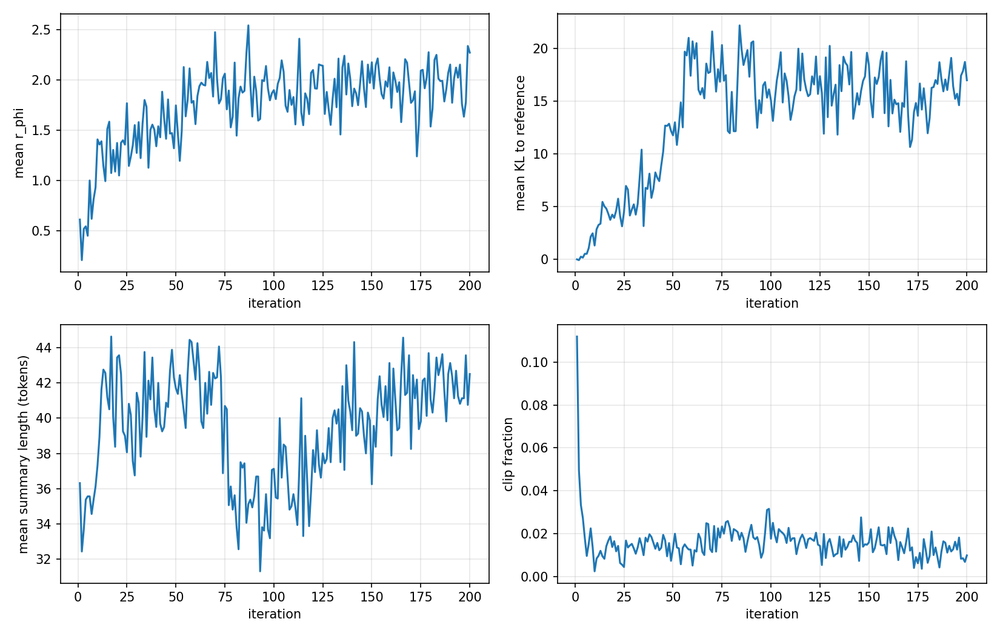
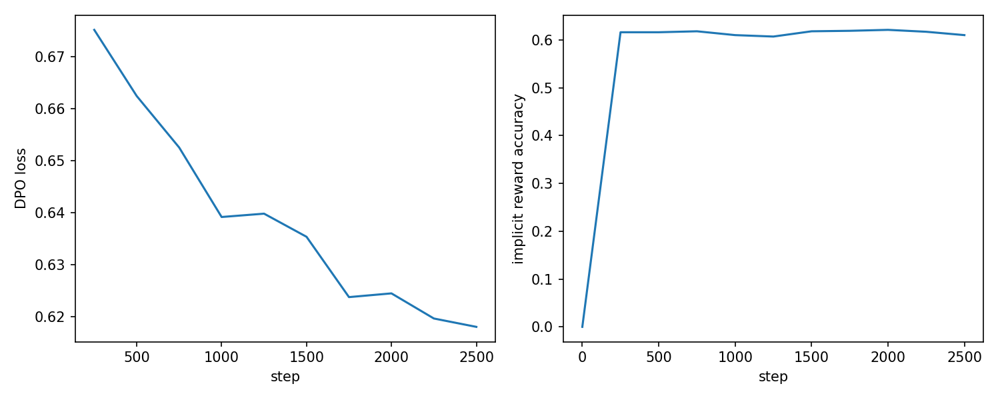

# Teaching a 135M-parameter model what a good TL;DR is: SFT, PPO and DPO from scratch

A pretrained language model can continue text, but it has no idea what makes a *good* summary. In this project we
took the smallest model we could find that still writes fluent English — SmolLM2-135M — and aligned it to human
judgements of summary quality, reproducing the pipeline of *Learning to Summarize from Human Feedback*
(Stiennon et al., 2020): the recipe that later became RLHF for ChatGPT.

Every loss in this post — supervised fine-tuning, the Bradley–Terry reward model, PPO and DPO — is our own PyTorch
code. No TRL, no PEFT, no Hugging Face `Trainer`. The whole pipeline trains in about 80 minutes on a single Colab GPU.
Code: [github.com/Areesha-008/Summarization-from-feedback](https://github.com/Areesha-008/Summarization-from-feedback).

## The task

The input is a Reddit post (subreddit, title, body) followed by `TL;DR:`; the output is a one-sentence summary. We
used the two datasets OpenAI released with the paper: ~130k posts with a human-written TL;DR, and ~260k pairs of
summaries of the same post where a labeller picked the better one. We trained on fixed subsets of 20,000 examples of
each and kept 300 unseen posts for the final comparison.

## Stage 1 — Supervised fine-tuning

First the model imitates human summaries. The loss is the usual next-token cross-entropy, but only on the summary
tokens: the prompt and the padding are masked out. One epoch over 20,000 pairs took 11 minutes and brought the
validation loss from 2.80 to 2.35 nats per token.

The difference is obvious immediately. On a post about a break-up, the base model loops: *"I'm not going to tell him
I'm sorry, I'm not going to tell him I'm sorry, …"*. After SFT: *"boyfriend said hurtful things to me, I'm still hurt
by it, what should I do?"*

## Stage 2 — A reward model

Next we need a number that says how good a summary is. We take the SFT model, remove its language-model head, and add
a single linear layer that reads the hidden state of the **last real token** of prompt + summary. (One trap: in this
tokenizer the padding token *is* the end-of-sequence token, so "last real token" has to come from the attention mask,
not from the token ids.) It is trained with the Bradley–Terry loss, −log σ(r(x, y_w) − r(x, y_l)): push the preferred
summary's score above the rejected one's.

After one epoch the reward model ranks 64.2% of 1,000 held-out pairs correctly. That is clearly above chance (50%) and
clearly below the paper's large models — what you would expect from 135M parameters and 20k pairs.

It also has a blind spot that matters later. When the human-preferred summary is the longer one, the reward model is
right 76.5% of the time; when it is the shorter one, only 46.4% — worse than a coin flip. Its most confident mistakes
are all short, abstract summaries ("TIFU by thinking I was being pranked") losing to long ones packed with copied
detail. **The reward model has learned that longer is better.**

## Stage 3 — PPO

PPO treats every generated token as an action. Each iteration we sample summaries for 16 prompts from the current
policy, score them with the frozen reward model, and give every token a small penalty for drifting from the SFT model:
−β·(log π − log π_SFT), with the reward-model score added on the final token. A value head on the policy estimates the
return from each token; the advantage (return minus value, normalised) drives four epochs of clipped policy-gradient
updates on that same batch. Three models sit in GPU memory: the policy with its value head, the frozen SFT reference
and the frozen reward model.

The curves tell the story. The mean reward climbs from 0.7 to about 2.0 in the first 60 iterations and then plateaus.
The KL to the SFT model jumps to 15–20 nats per summary at the same moment and stops there: from then on, the KL penalty
(about 0.05 × 17 ≈ 0.85 per summary) cancels out what further drifting would earn. The clip fraction starts at 11% —
the value head is brand new — and settles at 1–2%, so each update is small and PPO's clipping acts as a safety net
rather than a brake. Our sanity checks held throughout: KL exactly 0 at iteration 1, and a probability ratio of exactly
1 in the first epoch of every iteration.

## Stage 4 — DPO

DPO reaches the same goal without a reward model or any sampling. The KL-constrained objective PPO optimises has a
closed-form optimum, which means every policy implicitly defines a reward: β·log(π(y|x) / π_SFT(y|x)), up to a term
log Z(x) that depends only on the prompt. Put that into the Bradley–Terry loss and Z(x) cancels, because both
summaries share the prompt. What is left is a classification loss on the preference pairs that needs only the
log-probabilities of two models — the policy and the frozen SFT reference.

Training starts at exactly log 2 (the policy equals the reference, so every margin is zero) and falls to 0.62.
Measured as a classifier, DPO's implicit reward ranks 61.0% of the validation pairs correctly, close to the explicit
reward model's 64.2%.

## Results

We generated one greedy summary per policy for each of the 300 unseen posts:

| Policy | Mean reward-model score | Win rate vs. SFT | KL to SFT | Length (tokens) | ROUGE-L |
|---|---|---|---|---|---|
| SFT | 0.57 | – | 0 | 30.6 | 0.256 |
| PPO | 1.93 | 90.3% | 5.16 | 38.9 | 0.242 |
| DPO | 1.81 | 89.3% | 3.19 | 39.3 | 0.247 |

Both aligned policies beat SFT on the reward model nine times out of ten, and DPO gets almost all of PPO's gain while
staying much closer to the SFT model. ROUGE-L against the human reference drops slightly — the policies optimise the
reward model, not the reference — and the summaries get about eight tokens longer. That is the length bias from Stage
2 at work: 77 of PPO's 300 summaries hit the 48-token limit and are cut off mid-sentence, against 15 for SFT.

## Where the methods differ

Often the aligned models are simply better. For a post about a three-month relationship with a girlfriend who lives an
hour away:

- **SFT:** *"I feel like I'm with my girlfriend more than I am with her, but I don't know if this is normal or not."*
- **PPO:** *"Girl I've been seeing for ~3 months, she lives an hour away and I have conflicting feelings depending on
  whether I'm with her or not. Is this normal?"*

SFT's sentence contradicts itself; PPO's is close to what the human wrote. On another post SFT invents facts ("I'm a
girl, and I'm in a relationship") that PPO gets right.

But the reward model's blind spots show up too. For a neighbour who keeps reporting a parked car as abandoned:

- **SFT:** *"Neighbor keeps calling the cops on us and claims our car is an abandoned vehicle. How do I get her to
  leave us alone?"*
- **PPO:** *"Neighbor keeps calling the cops on us about parking too close to our unit. We live in a little parkway area
  and it's just 8 townhouses (two 4-unit structures) that share 4 public parking spots"*

SFT is almost the human reference. PPO wanders into parking-lot detail, drops the actual complaint and question, and
runs into the length limit. On other posts PPO and DPO repeat a phrase two or three times. These are exactly the
things a length-loving, 135M reward model fails to punish.

## What we learned

**A reward is only as good as the reward model.** PPO did what it was told: it raised the score. Whether that made the
summaries better depends on what the reward model actually measures, and here that includes "longer".

**The KL penalty is what keeps it honest.** Without β, nothing stops the policy from chasing the reward model's quirks
all the way to degenerate text. With it, the KL levelled off instead of exploding.

**DPO is the pragmatic choice.** It needs two models instead of three, no sampling loop, no value head and one
hyperparameter instead of five — and it got 91% of PPO's reward gain with a smaller KL. PPO earns its complexity when
you can score fresh samples online rather than learning from a fixed set of preferences.

**Check your precision.** Our first DPO run was stuck at a loss of log 2 (≈0.693) for 1,000 steps. The cause: recent
versions of `transformers` load SmolLM2 in its stored bfloat16, where updates of size 2e-6 round to zero. Casting to
float32 fixed it.

You can try all three models side by side in the Gradio app in the repository: paste a post, get the SFT, PPO and DPO
summaries with their reward-model scores.
